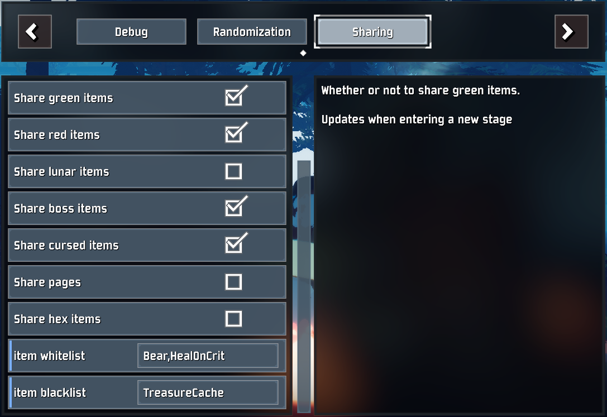

# Risk_of_Sharing
Risk of Rain 2 mod that shares items to all players

No more worrying about who gets what!

#### Notes:
- Items are shared to dead players too, so nobody spirals into weakness
- There currently is no balancing, everyone will be significantly stronger

## In-game settings

this mod can be configured in-game thanks to [RiskOfOptions](https://thunderstore.io/c/riskofrain2/p/Rune580/Risk_Of_Options/)

## Randomization

You can enable randomization to items of the same tier for both
- items sent to the other players
- items you pick up yourself (works in singleplayer too)

You can disable limiting randomization to the same tier, if you want extra craziness

## Item white- & blacklist

You can set your own white- & blacklists
- They use the **internal** names of items 
    - the example whitelist of `Bear,HealOnCrit` corresponds to Tougher Times & Harversters Scythe
    - You can find the internal names of items on [the Wiki](https://riskofrain2.wiki.gg/) as "ID"
- Whitelisted items will always be shared, even if they are part of your or the base blacklist 
    - you can add items regardless of their tier
    - example: if you wish for Rusted Keys to be shared, add their internal name of `TreasureCache` to your item whitelist

The base blacklist can be found in the plugins config file

## Other mods
### my other mods
- [Risk of Multiprinting](https://thunderstore.io/c/riskofrain2/p/mavo/Risk_of_Multiprinting/) - let's you print up to 50 items at once at 3D printers

### acknowledgements
- [ShareSuite](https://thunderstore.io/c/riskofrain2/p/FunkFrog-and-Sipondo/ShareSuite/) - serves the same purpose as this mod, don't run both at once. 
    - puts items directly in your inventory instead, has pickup notifications in chat and has balancing
    - a major inspiration for this mod, I started work on this mod because ShareSuite didn't work yet after DLC4 released
    - I hightly recommend checking it out!