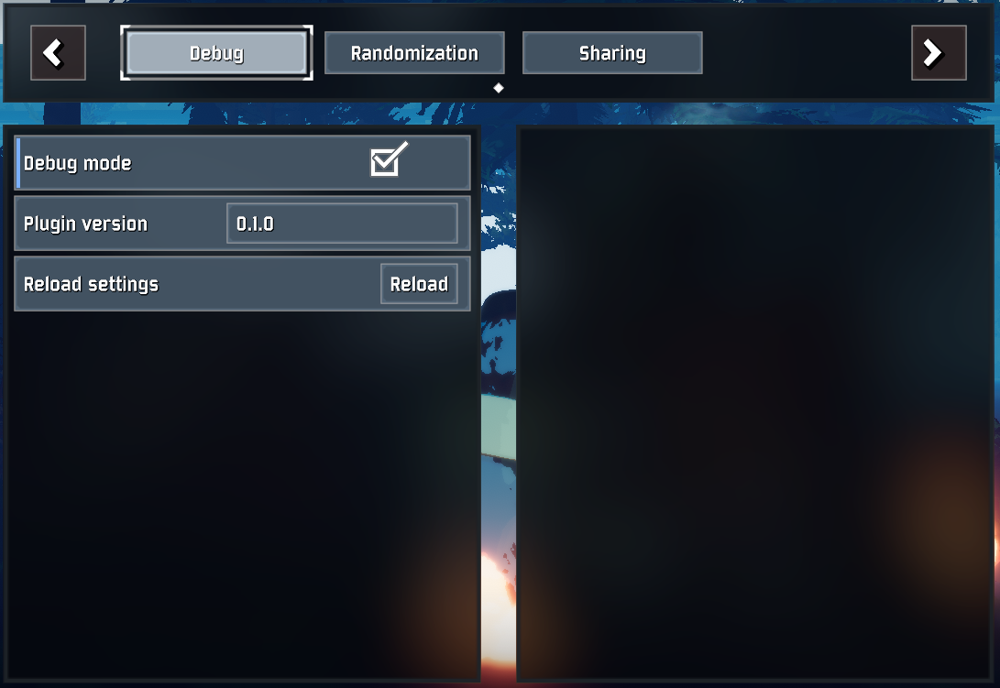
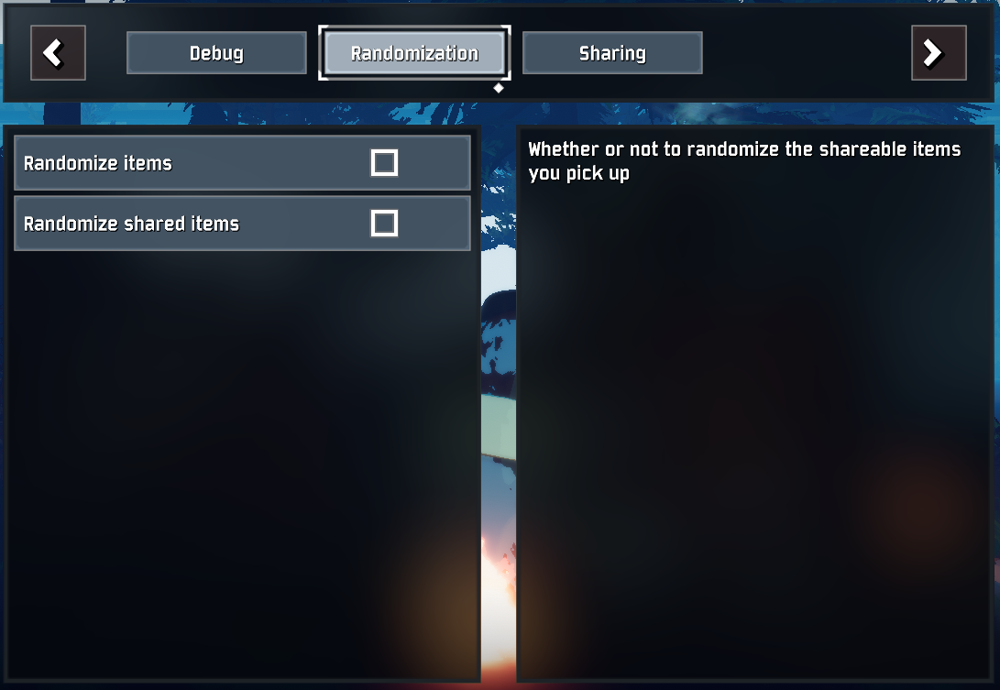

# risk_of_sharing
Risk of Rain 2 mod that shares items to all players

## In-game settings

this mod can be configured in-game thanks to [RiskOfOptions](https://thunderstore.io/c/riskofrain2/p/Rune580/Risk_Of_Options/)

## Randomization

You can enable randomization to items of the same tier for both
- items sent to the other players
- items you pick up yourself (works in singleplayer too)

## Item white- & blacklist

You can set your own white- & blacklists. 
- They use the **internal** names of items 
    - the example whitelist of `Bear,HealOnCrit` corresponds to Tougher Times & Harversters Scythe
    - You can find the internal names of items on [the Wiki](https://riskofrain2.wiki.gg/) as "ID"
- Whitelisted items will always be shared, even if they are part of your or the base blacklist 
    - you can add items regardless of their tier
    - example: if you wish for Rusted Keys to be shared, add their internal name of `TreasureCache` to your item whitelist

The base blacklist can be found in the plugins config file.